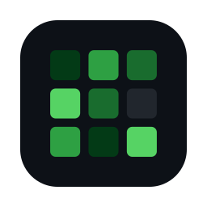
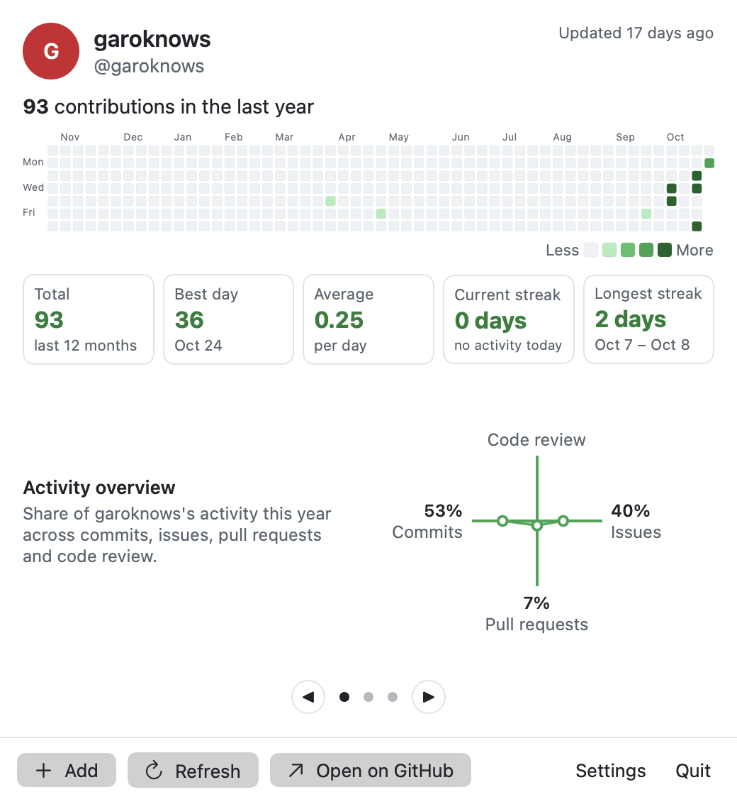
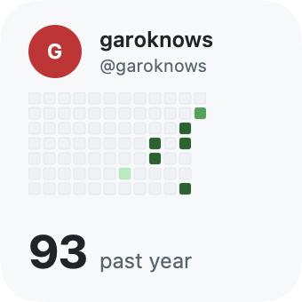
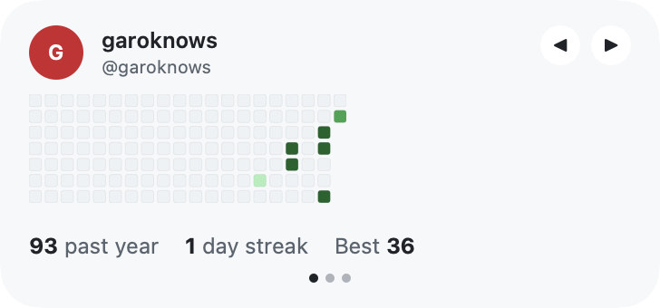
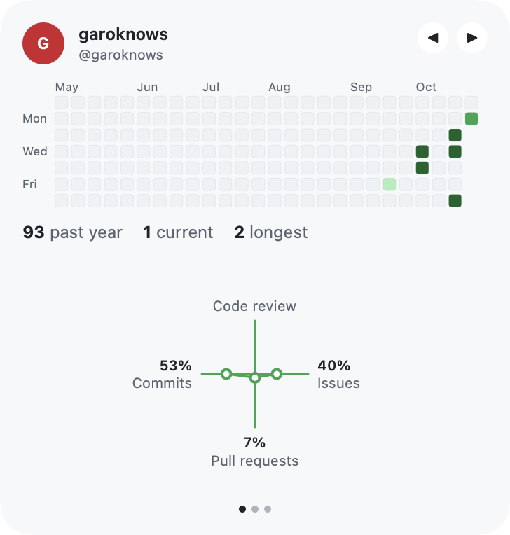
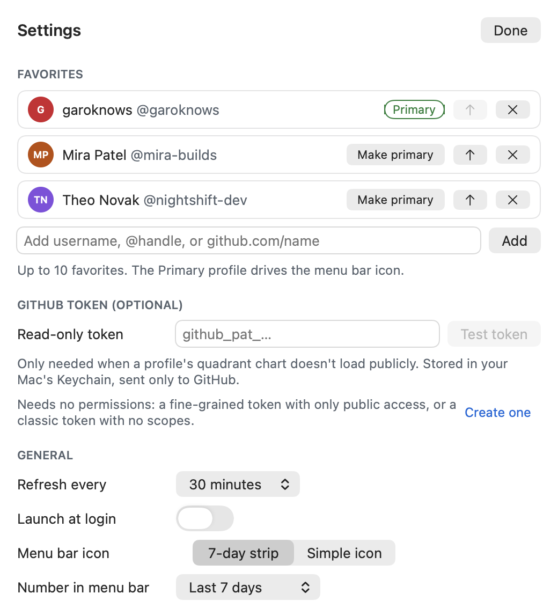
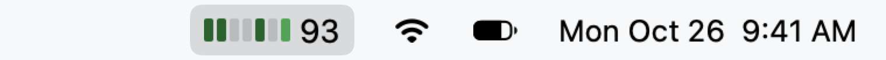

<p align="center">
  
</p>

<h1 align="center">Tracker for GitHub</h1>

<p align="center">
  See anyone's GitHub contribution graph and activity overview in your Mac menu bar and widgets.<br>
  Free, open source, no account, no tracking.
</p>

<p align="center">
  <a href="https://github.com/garoknows/github-tracker/releases/latest"><b>Download for Mac</b></a> ·
  <a href="https://garoknows.github.io/github-tracker/">Website and live demo</a> ·
  <a href="docs/INSTALL.md">Install guide</a> ·
  <a href="#faq">FAQ</a>
</p>

<p align="center">
  <a href="https://github.com/garoknows/github-tracker/actions/workflows/ci.yml"></a>
  
  
</p>

<p align="center">
  <picture>
    <source media="(prefers-color-scheme: dark)" srcset="docs/screenshots/popover-full-dark.png">
    
  </picture>
</p>

## What it does

- **Contribution graph** — the year of green squares, with month and weekday labels and a tooltip on every day ("7 contributions on Oct 21, 2026").
- **Stats** — total for the last year, best day, average per day, current streak and longest streak.
- **Activity overview** — GitHub's four-way chart of Commits, Issues, Pull requests and Code review, read from the public profile. No token needed for most people.
- **Favorites** — keep up to 10 people and flip between them with a two-finger swipe, the ← → keys or the ◀ ▶ buttons. Your Primary profile shows as a 7-day strip right in the menu bar.
- **Number in the menu bar (optional)** — Settings → Number in menu bar shows your last 7 days, your current streak or your last-year total next to the icon. It's off unless you turn it on.
- **Widgets** — Small, Medium and Large, on the desktop or in Notification Center, with ◀ ▶ buttons to cycle through up to 5 people.
- **Works offline** — shows the last data it saw, with "Offline, showing data from 2 hr ago." If GitHub changes its page, it says so instead of guessing.
- **Themes** — GitHub Green, Halloween, Ocean and Mono, in light and dark.

<p align="center">
  <picture>
    <source media="(prefers-color-scheme: dark)" srcset="docs/screenshots/widget-small-dark.png">
    
  </picture>
  <picture>
    <source media="(prefers-color-scheme: dark)" srcset="docs/screenshots/widget-medium-dark.png">
    
  </picture>
  <br>
  <picture>
    <source media="(prefers-color-scheme: dark)" srcset="docs/screenshots/widget-large-dark.png">
    
  </picture>
  <picture>
    <source media="(prefers-color-scheme: dark)" srcset="docs/screenshots/settings-dark.png">
    
  </picture>
</p>

<p align="center">
  <picture>
    <source media="(prefers-color-scheme: dark)" srcset="docs/screenshots/menubar-number-dark.png">
    
  </picture>
</p>

## Install

**Download:**
1. Download **Tracker-for-GitHub-x.y.z.dmg** from the [latest release](https://github.com/garoknows/github-tracker/releases/latest).
2. Open it and drag **Tracker for GitHub** into **Applications**.
3. Open the app. It's signed and notarized by Apple, so macOS only asks you to confirm the first time.
4. Click the graph icon in your menu bar and type a GitHub username.

**Or with [Homebrew](https://brew.sh):**

```sh
brew install --cask garoknows/tap/tracker-for-github
```

Step-by-step pictures: **[docs/INSTALL.md](docs/INSTALL.md)**.

## Build from source

You need macOS 14+ and **Xcode** (free in the Mac App Store).

```sh
git clone https://github.com/garoknows/github-tracker.git
cd github-tracker
./scripts/install.sh
```

The script builds a Release copy, puts it in `/Applications` and opens it. It prints a clear message if Xcode is missing.

For development, run `swift test --package-path Packages/TrackerKit` for the unit tests (no network needed), and see [CONTRIBUTING.md](CONTRIBUTING.md). The Xcode project is generated from `project.yml` with [XcodeGen](https://github.com/yonaskolb/XcodeGen).

## FAQ

**Why is the quadrant chart missing for someone?**
GitHub only shows "Activity overview" for people who turned it on in their profile settings. If they did and it's still missing, paste a free read-only token in Settings. It needs no permissions at all ([create one](https://github.com/settings/personal-access-tokens/new)).

**Does it show private work?**
Only as anonymous squares, and only if that person turned on "Private contributions" on their profile. Private repo names and code are never shown. That's how GitHub's own profile works too.

**Does the total match github.com?**
Yes. The graph comes from the same public page GitHub uses for profiles, and the colors use GitHub's own intensity levels.

**Why can't I swipe the widgets?**
macOS widgets only support clicks on buttons, so they have ◀ ▶ instead. Swiping works in the menu bar popover.

**Can the widgets use my app favorites?**
Yes. Widgets show your app favorites automatically. To show different people in one widget, right-click it → Edit Widget, turn off **Use my app favorites** and type up to 5 usernames.

**What does the number next to the menu bar icon mean?**
It's off unless you choose one in Settings → Number in menu bar: **Last 7 days** (the same days as the 7-day strip), **Current streak** (days in a row) or **Last year total**. It always describes your Primary profile and matches the card at any hour. Above 9,999 it's shortened, like 12.3k. Offline it keeps the last number it saw.

**Why does the streak say "through" a date instead of "today"?**
GitHub groups contributions by UTC day, so in the Americas its new day starts in the late afternoon. The streak shows the date of its last active day the way GitHub's own graph labels it, for example "through Nov 12", so it's right at any hour.

**How often does it refresh?**
Every 30 minutes by default (15 min to 3 hr in Settings). Widgets refresh about every 30 minutes. Refresh in the popover updates right away.

**Something broke after GitHub changed its site.**
The card says "GitHub changed its page" when that happens, and keeps your last good data instead of guessing. Please [open an issue](https://github.com/garoknows/github-tracker/issues). All of GitHub's page format is handled in one place with saved test pages, so fixes are quick. See [docs/DATA-SOURCES.md](docs/DATA-SOURCES.md).

## Privacy

- No account, no server, no analytics, no third-party code.
- The app talks only to **github.com** and **api.github.com**, plus GitHub's avatar image host for profile pictures.
- The optional token lives only in your **macOS Keychain**, where the app and its widget can both read it. It's never written to disk, settings or logs, and only ever sent to **api.github.com**, over HTTPS.
- The app and widgets run in Apple's App Sandbox with outgoing network access only.

Details in [SECURITY.md](SECURITY.md).

## Credits

Built with ideas (not code) from these projects. Thank you!

| Project | License | What it inspired |
|---|---|---|
| [menubar-apps/StreakBar](https://github.com/menubar-apps/StreakBar) | GPL-3.0 | Menu bar graph, Homebrew tap |
| [JustinFincher/GitHubContributionsiOS](https://github.com/JustinFincher/GitHubContributionsiOS) | GPL-3.0 | Contribution widgets |
| [lukaskaibel/issues-for-github](https://github.com/lukaskaibel/issues-for-github) | MIT | Reference for the planned v2 sign-in and issue cards |
| [mohummudh/contributions](https://github.com/mohummudh/contributions) | No license declared | Unauthenticated scraping in a native widget |
| [Jeetchavan02/Macos-Github-Widget](https://github.com/Jeetchavan02/Macos-Github-Widget) | No license declared | Swift 6 widget, offline cache |
| [SekulDev/GithubContributionWidgetMacOS](https://github.com/SekulDev/GithubContributionWidgetMacOS) | MIT | One-command install script |

No code from the GPL-licensed projects was copied into this MIT project.

## Support

Tracker for GitHub is free. If it's useful to you, you can [sponsor its development](https://github.com/sponsors/garoknows).

## License

[MIT](LICENSE) © garoknows

---

<sub>Tracker for GitHub is an independent project. It is not affiliated with, endorsed by, or sponsored by GitHub, Inc. "GitHub" is a trademark of GitHub, Inc.</sub>
