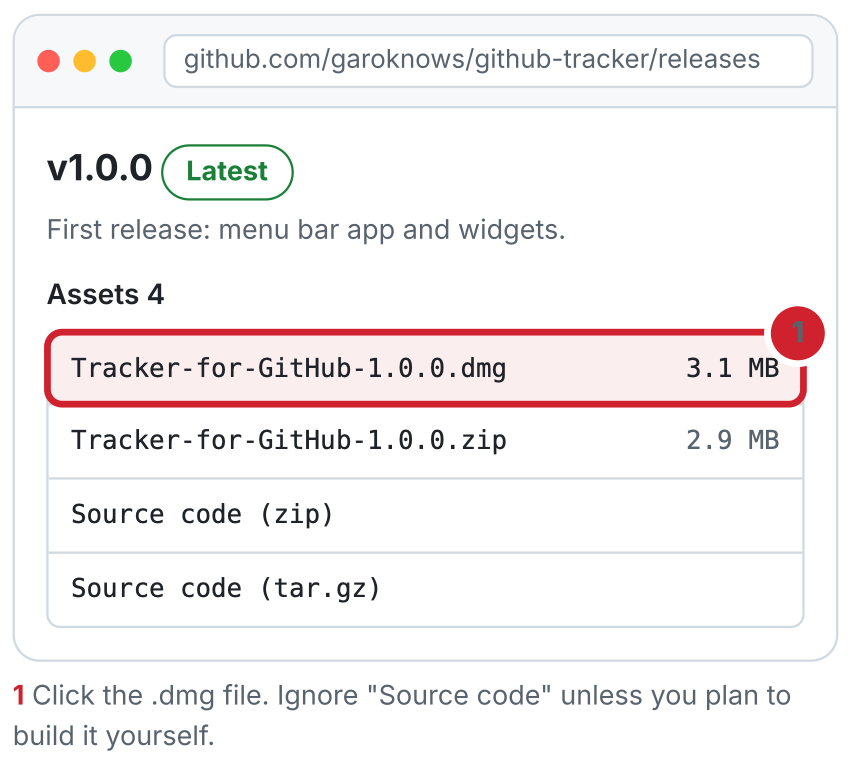
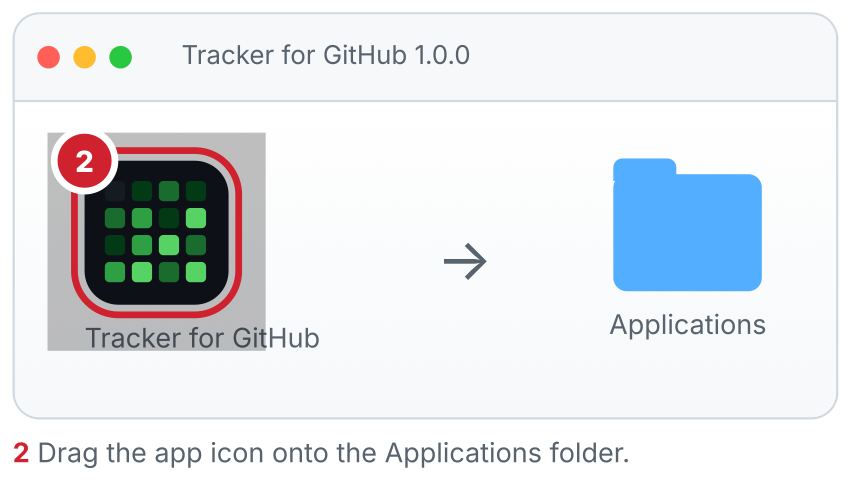
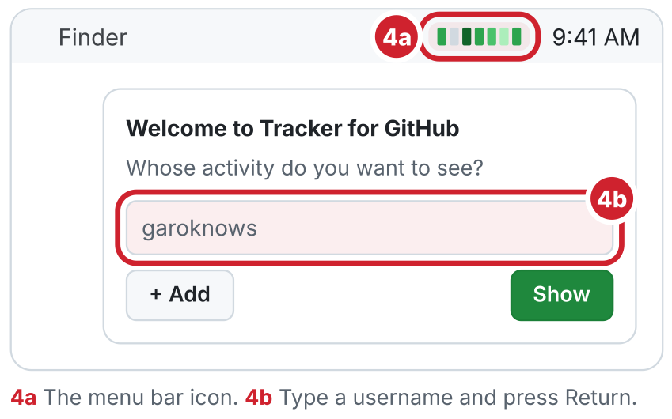
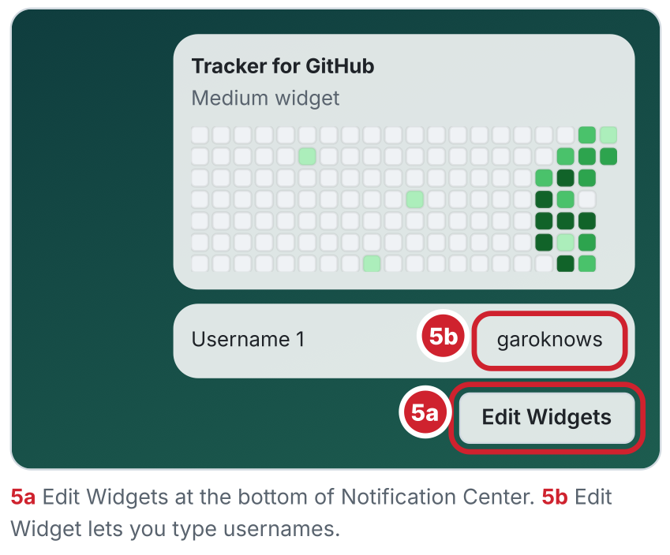
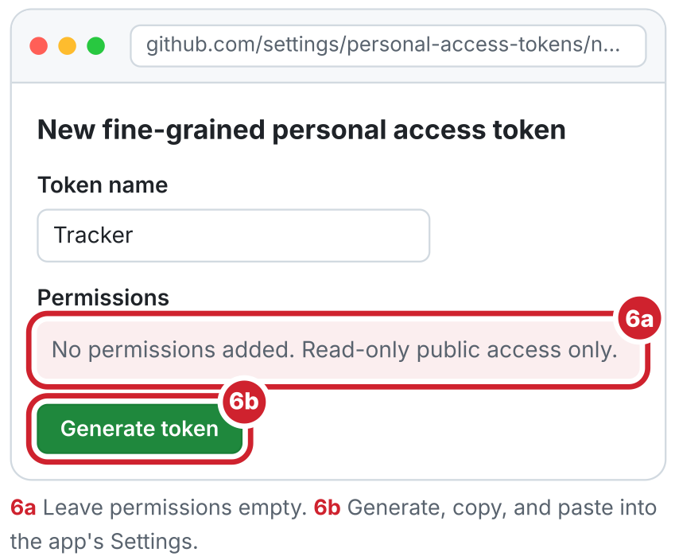

# Install and use Tracker for GitHub

A plain-language guide for anyone. Download the app, open it, then add the people you want to follow. About 5 minutes. Works on **macOS 14 Sonoma or later**, on Apple silicon and Intel Macs.

Prefer Homebrew? Run `brew install --cask garoknows/tap/tracker-for-github` in Terminal and skip to step 4.

---

## 1. Download the app

1. Go to [github.com/garoknows/github-tracker](https://github.com/garoknows/github-tracker).
2. On the right side, click **Releases**, then the newest version. (Or go straight to the [latest release](https://github.com/garoknows/github-tracker/releases/latest).)
3. Under **Assets**, click the file ending in **`.dmg`**. It lands in your Downloads folder.



## 2. Drag it into Applications

1. Double-click the downloaded `.dmg`. A small window opens.
2. Drag the **Tracker for GitHub** icon onto the **Applications** folder.
3. Close the window, then drag the disk icon off your desktop (or right-click it and choose **Eject**).



## 3. Open it

The app is signed and notarized by Apple, so it opens like any app you download.

1. Open **Applications** and double-click **Tracker for GitHub**.
2. The first time, macOS asks if you're sure you want to open an app downloaded from the Internet. Click **Open**.

## 4. Add yourself and your favorites

1. Look at the top-right of your screen. Click the small graph icon in the menu bar.
2. Type a GitHub username, an @handle, or paste a profile link (like `github.com/garoknows`). Press **Return**.
3. Click **＋ Add** to save more people, up to 10.
4. Flip between them with a **two-finger swipe**, the **← →** keys, or the **◀ ▶** buttons.

> Want it to start automatically? Open **Settings** in the popover and turn on **Launch at login**.



## 5. Put it on your desktop or in Notification Center

1. Click the **date and time** in the menu bar to open Notification Center. Scroll to the bottom and click **Edit Widgets**. (For the desktop: right-click the desktop → **Edit Widgets**.)
2. Search for **Tracker**. Pick **Small**, **Medium** or **Large** and drag it where you want.
3. The widget shows your app favorites automatically. To show different people, right-click it → **Edit Widget**, turn off **Use my app favorites** and type up to 5 usernames.
4. On Medium and Large widgets, click **◀ ▶** to flip between them.

> Widgets can't be swiped on a Mac. That's an Apple limit, which is why they have buttons.



## 6. Optional: unlock the quadrant chart with a token

The four-way Commits / Issues / Pull requests / Code review chart usually loads publicly. If it's missing for someone who has it turned on, a free GitHub **token** (a read-only key) fixes it. A token with no permissions can't change anything on your account.

1. On github.com, click your picture → **Settings → Developer settings → Personal access tokens → Fine-grained tokens** (or go to [this page](https://github.com/settings/personal-access-tokens/new)).
2. Click **Generate new token**. Name it "Tracker", pick an expiration, and **leave every permission off**.
3. Click **Generate token** and copy it. GitHub shows it only once.
4. In the app: **Settings → GitHub token → paste → Test token**.

> The token is stored in your Mac's Keychain and sent only to GitHub. Delete it anytime on GitHub.
> Widgets can't read the app's Keychain in this free build, so they always use the public chart.



---

## Build it yourself (for developers)

You need **Xcode** (free in the Mac App Store). Run these one at a time in Terminal:

```sh
git clone https://github.com/garoknows/github-tracker.git
```

```sh
cd github-tracker
```

```sh
./scripts/install.sh
```

The script builds the app, copies it into Applications and opens it. If Xcode is missing, it tells you exactly what to install.

## Update or remove

- **Update:** Settings → About → **Check for updates** opens the newest release. Download it and drag it into Applications, replacing the old one. With Homebrew: `brew upgrade --cask tracker-for-github`.
- **Remove:** click the menu bar icon → **Quit**, remove any widgets (Edit Widgets → ⊖), then drag the app from Applications to the Trash.

## FAQ

**Is it safe to open?**
Yes. Every release is signed with an Apple Developer ID and notarized, which means Apple scanned it for malware before you download it. The source code is public too, so anyone can check what it does.

**Why is the quadrant chart missing for someone?**
GitHub only shows it for people who turned on "Activity overview" in their profile settings. If they did and it's still missing, add a token in Settings (step 6).

**Does it show private work?**
Only as anonymous green squares, and only if that person turned on "Private contributions" on their GitHub profile. It never shows private repo names or code.

**What data does it collect?**
None. There's no account, no server and no analytics. It only downloads public data from GitHub and keeps a small cache on your Mac so it works offline.

**Why can't I swipe the widget?**
macOS widgets only support clicks on buttons. Swiping works in the menu bar popover.
